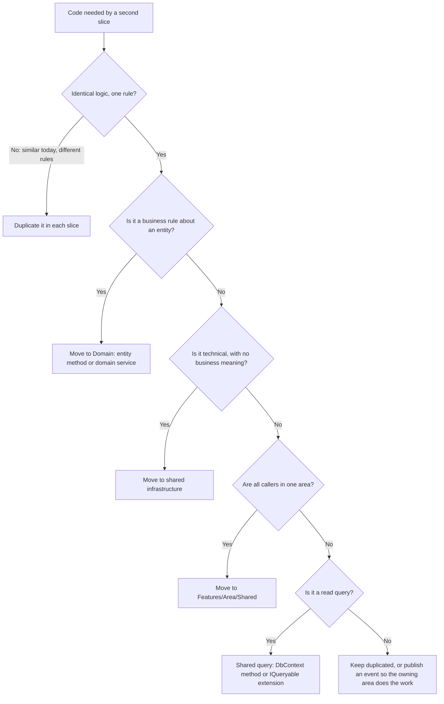

# Shared logic: where things belong

## Placement table

| Thing | Location (Layout A) | Rule |
| --- | --- | --- |
| Logic one slice uses | Inside the slice | Default for everything new |
| Logic two or more slices in one area use | `Features/<Area>/Shared/` | Area-level sharing only; never referenced from another area |
| Entity, value object, invariant | `Domain/<Aggregate>/` | Shared by all slices; owned by no slice |
| Domain service (rule spanning several entities, no I/O) | `Domain/<Aggregate>/` or `Domain/Services/` | Pure; takes entities, returns decisions |
| Domain event type | `Domain/<Aggregate>/Events/` | Raised by entities; handled in slices or infrastructure |
| Shared kernel (Evans) | `SharedKernel/` or a `*.SharedKernel` project | Small; changed only with agreement from every module that uses it |
| `DbContext` / `ISession` factory, entity configuration, migrations | `Infrastructure/Persistence/` | One place; knows entities, never slices |
| Shared read query used across areas | Method on the `DbContext`, extension on `IQueryable<T>`, or `Infrastructure/Queries/` | Small and named; returns projections, not entities with behavior |
| External API client | `Infrastructure/Clients/<System>/` | Typed client or SDK wrapper; a seam (interface) when tests need a fake |
| Pipeline steps, endpoint filters, exception handlers | `Infrastructure/Pipeline/` (or `Behaviors/`, `Filters/`) | Generic over request types; knows no slice |
| Cross-cutting technical helpers (clock, ID generation, current user) | `Infrastructure/` | Prefer BCL types (`TimeProvider`, `Guid.CreateVersion7`) |
| Configuration options | Next to the code that consumes them; `Infrastructure/` when several areas consume them | Validate on start |
| Area endpoint registration (`MapOrders`) | `Features/<Area>/<Area>Endpoints.cs` | Lists the area's slices |
| Area DI registration (`AddOrdersFeature`) | `Features/<Area>/<Area>Registration.cs` | Lists the area's handlers and options |
| Composition (`Program.cs`) | Host project root | Calls area registrations only |

In split layouts (D, E, F in [project-layouts.md](project-layouts.md)) the same placement holds, with
`Domain` and `Infrastructure` as projects.

## "Services"

A class named `*Service` is a smell only when it is a layer by habit: one per entity, called by every
slice, holding several use cases' logic. These are legitimate:

- A **domain service**: a pure rule that spans entities (`PricingPolicy.Calculate(order, customer)`).
- An **infrastructure service**: a technical capability (`IEmailSender`, `IBlobStore`).
- An **area-shared helper** that two slices use and that encodes one rule.

When you find an `OrderService` with `Create`, `Cancel`, `Get`, `List`, split each method into the slice it
serves.

## Promotion decision tree

## Boundary test for shared code

Before you add code to any shared location, ask: if every caller but one were deleted, would this code
still make sense unchanged? A validation filter passes. A `ProcessOrder` helper that branches on order
status fails; it is one slice's logic with a shared name, and it belongs in that slice.

Signs shared code has drifted into a hidden layer:

- The shared folder grows faster than the number of slices.
- Shared methods take domain types and branch on their state.
- A shared helper has one caller.
- Shared code references a slice's request or response type.

## Domain placement and seams

VSA works with any amount of domain modeling. Start slices as transaction scripts and move logic into the
domain when a smell appears:

| Smell in a handler | Refactor |
| --- | --- |
| The same invariant checked in several handlers | Entity method that enforces it (`order.Cancel(now)`) |
| A handler mutates many properties of one entity in a fixed order | Entity method or factory (`Order.Place(...)`) |
| A rule spans several entities and has no I/O | Domain service |
| A write must cause a side effect in another area | Domain event raised by the entity; handled in the other area |
| Several slices load the same aggregate with the same includes | A load method on the `DbContext` or an aggregate repository (see [data-access.md](data-access.md)) |

The domain stays free of slices, transport, and persistence: no request records, no `IResult`, no
`DbContext`. Entity configuration lives in infrastructure.

Designing aggregates, value objects, and bounded contexts is outside this skill's scope; it is a deep
discipline of its own. This skill covers where those types live relative to slices and how a handler uses
them.
