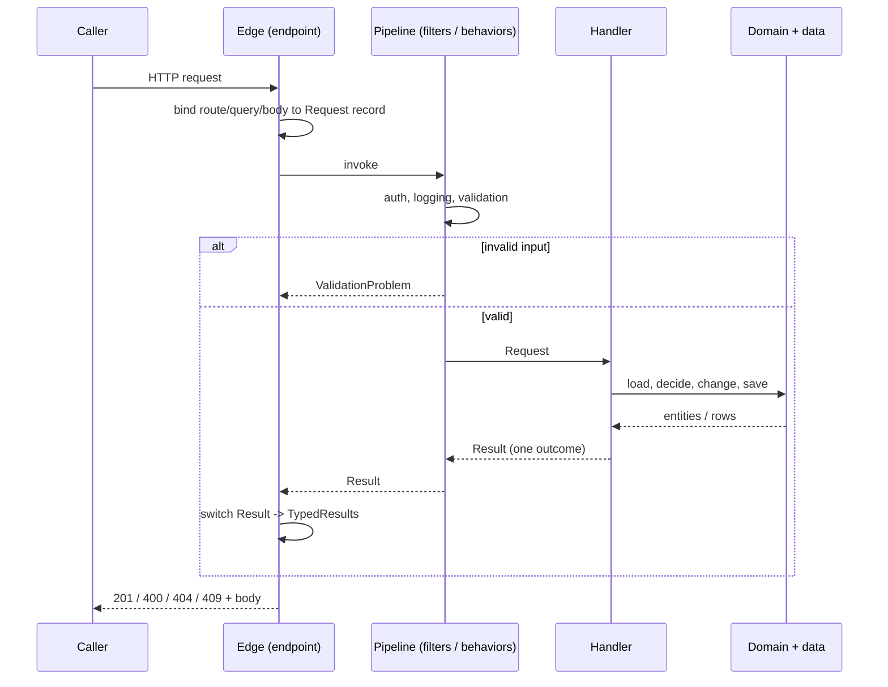

# Slice anatomy

## Parts of a slice

| Part | Required | Shape |
| --- | --- | --- |
| Request | yes | `sealed record`, named `<UseCase>Request` / `Command` / `Query`. Input only. |
| Response | when the use case returns data | `sealed record` shaped for this caller. Never an ORM entity. |
| Result | when there is more than one outcome | `union` (C# 15+) or closed record hierarchy of outcomes. See [results-and-errors.md](results-and-errors.md). |
| Validator | when input has rules | Attributes on the request, or a validator type. See [validation.md](validation.md). |
| Handler | yes | Runs the use case. Static method, class, or mediator handler. See [patterns.md](patterns.md). |
| Edge mapping | yes | Endpoint, consumer, job, page, gRPC method, or CLI command that calls the handler. See [entry-points.md](entry-points.md). |
| Tests | yes | Mirrored folder in the test project. See [testing.md](testing.md). |

## Flow



Rules this flow encodes:

- Binding and transport mapping stay in the edge. The handler sees a request record and returns a result;
  it knows nothing about HTTP status codes.
- The pipeline handles concerns that apply to many slices. A slice adds or skips steps through metadata
  (endpoint filters, group conventions, marker interfaces), not by editing shared code.
- The handler owns its data access. It loads exactly what this use case needs.
- The response is built for this slice. Two slices never share a response type.

## Worked example: Layout A, C# 15 / .NET 11

```csharp
// Features/Orders/CreateOrder/CreateOrderRequest.cs
namespace MyApp.Features.Orders.CreateOrder;

public sealed record CreateOrderRequest(Guid CustomerId, IReadOnlyList<CreateOrderLine> Lines);
public sealed record CreateOrderLine(string Sku, int Quantity);
```

```csharp
// Features/Orders/CreateOrder/CreateOrderResult.cs
namespace MyApp.Features.Orders.CreateOrder;

public sealed record OrderCreated(Guid OrderId, string OrderNumber);
public sealed record CustomerMissing(Guid CustomerId);
public sealed record ProductsUnavailable(IReadOnlyList<string> Skus);

public union CreateOrderResult(OrderCreated, CustomerMissing, ProductsUnavailable);
```

Name outcome cases after the domain (`OrderCreated`, `CustomerMissing`). `Created` and `NotFound` collide
with `Microsoft.AspNetCore.Http.HttpResults` types.

```csharp
// Features/Orders/CreateOrder/CreateOrderHandler.cs
namespace MyApp.Features.Orders.CreateOrder;

internal sealed class CreateOrderHandler(AppDbContext db, TimeProvider clock)
{
    public async Task<CreateOrderResult> HandleAsync(CreateOrderRequest request, CancellationToken ct = default)
    {
        bool customerExists = await db.Customers
            .AnyAsync(c => c.Id == request.CustomerId, ct)
            .ConfigureAwait(false);
        if (!customerExists)
        {
            return new CustomerMissing(request.CustomerId);
        }

        string[] skus = [.. request.Lines.Select(l => l.Sku).Distinct()];
        Dictionary<string, Product> products = await db.Products
            .Where(p => skus.Contains(p.Sku) && p.IsActive)
            .ToDictionaryAsync(p => p.Sku, ct)
            .ConfigureAwait(false);

        string[] missing = [.. skus.Where(s => !products.ContainsKey(s))];
        if (missing.Length > 0)
        {
            return new ProductsUnavailable(missing);
        }

        Order order = Order.Place(
            request.CustomerId,
            request.Lines.Select(l => (products[l.Sku], l.Quantity)),
            clock.GetUtcNow());

        db.Orders.Add(order);
        await db.SaveChangesAsync(ct).ConfigureAwait(false);

        return new OrderCreated(order.Id, order.Number);
    }
}
```

```csharp
// Features/Orders/CreateOrder/CreateOrderEndpoint.cs
namespace MyApp.Features.Orders.CreateOrder;

internal static class CreateOrderEndpoint
{
    public static RouteHandlerBuilder Map(RouteGroupBuilder orders) =>
        orders.MapPost("/", HandleAsync)
            .WithName("CreateOrder")
            .WithSummary("Place a new order for a customer.");

    private static async Task<Results<Created<OrderCreated>, NotFound, ValidationProblem>> HandleAsync(
        CreateOrderRequest request, CreateOrderHandler handler, CancellationToken ct)
    {
        CreateOrderResult result = await handler.HandleAsync(request, ct).ConfigureAwait(false);
        return result switch
        {
            OrderCreated created => TypedResults.Created($"/orders/{created.OrderId}", created),
            CustomerMissing => TypedResults.NotFound(),
            ProductsUnavailable unavailable => TypedResults.ValidationProblem(
                new Dictionary<string, string[]>
                {
                    ["Lines"] = [.. unavailable.Skus.Select(s => $"'{s}' is unavailable.")],
                }),
            null => throw new UnreachableException("Handler returned a default CreateOrderResult."),
        };
    }
}
```

```csharp
// Features/Orders/OrdersEndpoints.cs
namespace MyApp.Features.Orders;

internal static class OrdersEndpoints
{
    public static IEndpointRouteBuilder MapOrders(this IEndpointRouteBuilder app)
    {
        RouteGroupBuilder orders = app.MapGroup("/orders").WithTags("Orders").RequireAuthorization();
        CreateOrder.CreateOrderEndpoint.Map(orders);
        GetOrderById.GetOrderByIdEndpoint.Map(orders);
        return app;
    }
}
```

Notes:

- The `null` arm handles a `default` union, whose value is null. The compiler does not always warn about a
  missing `null` arm, and the switch then throws `SwitchExpressionException` at runtime. Keep the arm, and
  prefer it over `_`, which hides the warning when you add a case later. The `null` arm throws because a
  default union here is a bug, not an expected outcome.
- Input shape rules (required fields, ranges) run before the handler in the validation step. The handler
  returns `ProductsUnavailable` because only the database knows it; that is a business outcome, not a
  shape error.
- Register the handler in DI (`services.AddScoped<CreateOrderHandler>()`), or use the repo's dispatch
  style. See [patterns.md](patterns.md).
- Under C# 14 / .NET 10, `CreateOrderResult` is an abstract record with a private constructor. See
  [results-and-errors.md](results-and-errors.md).

## Query slice

A query slice projects straight to its response. It does not load tracked entities and map them
afterwards.

```csharp
namespace MyApp.Features.Orders.GetOrderById;

public sealed record GetOrderByIdResponse(
    Guid Id, string Number, string Status, decimal Total, IReadOnlyList<GetOrderByIdLine> Lines);
public sealed record GetOrderByIdLine(string Sku, int Quantity, decimal UnitPrice);

internal sealed class GetOrderByIdHandler(AppDbContext db)
{
    public Task<GetOrderByIdResponse?> HandleAsync(Guid id, CancellationToken ct = default) =>
        db.Orders
            .AsNoTracking()
            .Where(o => o.Id == id)
            .Select(o => new GetOrderByIdResponse(
                o.Id,
                o.Number,
                o.Status.ToString(),
                o.Lines.Sum(l => l.Quantity * l.UnitPrice),
                o.Lines.Select(l => new GetOrderByIdLine(l.Sku, l.Quantity, l.UnitPrice)).ToList()))
            .SingleOrDefaultAsync(ct);
}
```

A nullable response is enough when the only alternative outcome is "not found". Use a result union or
closed hierarchy when there are two or more alternatives.

## Async and cancellation

Every slice is async from the edge to the database, and one `CancellationToken` flows through it.

| Rule | Detail | Analyzer |
| --- | --- | --- |
| Async I/O only | No `.Result`, `.Wait()`, or `GetAwaiter().GetResult()`. Use the async ORM, HTTP, and file APIs. | VSTHRD002 if the repo uses Microsoft.VisualStudio.Threading.Analyzers |
| Token parameter | Every async method other code calls takes `CancellationToken ct = default` as its **last** parameter: handlers, area `Shared/` helpers, domain services, infrastructure, repository and unit-of-work members. | CA1068 |
| Token flows | Each caller passes the token it received. Never call `HandleAsync(request)` and let the default apply when a token is in scope. `CancellationToken.None` is only for work that must finish regardless of the caller; tests pass the test framework's token (see [testing.md](testing.md#fixture-shape)). | CA2016 |
| Token source | The edge takes the token from its framework: Minimal API and MVC parameters (bound to `HttpContext.RequestAborted`), `ServerCallContext.CancellationToken` in gRPC, the consumer context in messaging, `stoppingToken` in a `BackgroundService`, the action's token in System.CommandLine. Edge delegates the framework binds need no `= default`. | — |
| `ConfigureAwait(false)` | On every `await` in `src/`, including edges, `await foreach` (`.WithCancellation(ct).ConfigureAwait(false)`), and `await using` (see below). ASP.NET Core has no `SynchronizationContext`, so it costs nothing there, and it keeps handlers and shared code safe when a UI edge (Blazor, WPF, MAUI) calls them. | CA2007 |
| Exceptions to `ConfigureAwait(false)` | UI components and code-behind that touch UI state after the await. Test methods: xUnit warns against it (xUnit1030). | — |

`CancellationToken` is a struct. Its default is `CancellationToken.None`, not `null`; do not use
`CancellationToken?`.

`await using` with `ConfigureAwait(false)` needs a separate variable for the resource:

```csharp
using System.Runtime.CompilerServices;   // ConfiguredAsyncDisposable

AsyncServiceScope scope = scopes.CreateAsyncScope();
await using ConfiguredAsyncDisposable scopeLifetime = scope.ConfigureAwait(false);
```

Turn the rules into build warnings in `src/` and switch the `ConfigureAwait` rule off for tests. With
`TreatWarningsAsErrors`, they fail the build:

```ini
# .editorconfig at the repo root
[src/**.cs]
dotnet_diagnostic.CA1068.severity = warning   # CancellationToken parameter last
dotnet_diagnostic.CA2016.severity = warning   # forward the CancellationToken
dotnet_diagnostic.CA2007.severity = warning   # ConfigureAwait on every await

[tests/**.cs]
dotnet_diagnostic.CA2007.severity = none
```

In a behavior-preserving migration, passing the token to a write that did not get it before means the
write can now roll back when the client disconnects. Pass it anyway, and list the change in the migration
report; the client that disconnected sees no response either way.

## Record DTO conventions

- `sealed record` for requests, responses, and outcome cases. Positional records for short shapes;
  `required` `init` properties for long ones.
- Collections as `IReadOnlyList<T>`. Do not expose `List<T>` or arrays a caller could mutate.
- Nullable reference types on. A nullable member means "may be absent", never "not validated yet".
- One response per slice. Reuse inside a slice is fine (an edit slice's query can return its own command
  shape as the form model, as ContosoUniversity does). Reuse across slices is not.
- No ORM entities, `IQueryable<T>`, or lazy-loading proxies in requests or responses.
- Map by hand or by projection. A mapping library is fine when the repo already uses one.
- For MVC and Razor Pages, put validation attributes on record constructor parameters. MVC ignores
  attributes on record properties when it binds through the constructor
  (<https://learn.microsoft.com/aspnet/core/mvc/models/model-binding#constructor-binding-and-record-types>).

## Sizing a slice

A slice boundary matches something a caller triggers independently and describes in one sentence
("cancel an order"). Two failure directions:

- **Too coarse**: one handler serves several use cases through a mode flag (`if (request.Mode == ...)`).
  Split along the flag.
- **Too fine**: two "slices" always run back to back and never alone (`ValidateOrder`, then
  `PersistOrder`). Merge them.

Deliberate merges are acceptable: ContosoUniversity's `Instructors/CreateEdit` serves create and edit with
one form because the two share every rule.
